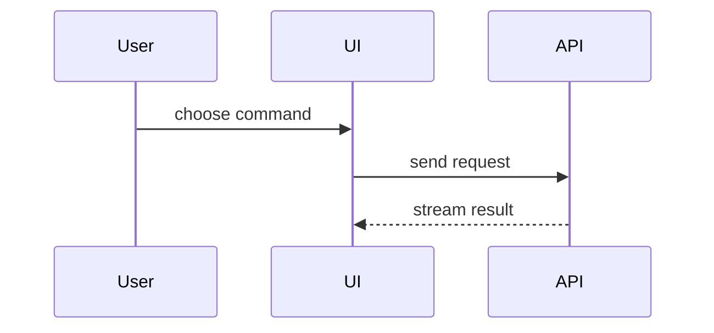

# Draw the Owl

Read [`human-friendly`](../human-friendly/SKILL.md) before writing any text a person will read. Use plain words for a reader new to the topic. Keep commands, paths, numbers and dates exact.

Help the user understand the current topic visually. Skip the preamble and keep prose brief. Pick the smallest view that makes the key point clear.

## Views

- Logic or an algorithm as pseudocode:

```text
on(save)
  if content is unchanged
    return cached result
  write new content
  return fresh result
```

- Runtime control flow as a call tree:

```text
submitForm
  createSession
    persistPrompt
    launchAgent
  navigateToSession
```

- UI structure as a component tree, with the state and module boundaries that matter:

```tsx
<SettingsPage> (app/routes/settings.tsx)
  useUserSettings()
  <SettingsForm>
    <SaveButton> (packages/ui)
```

- File responsibility or a broad refactor as a shallow file tree:

```text
src/
├── commands/       # parses user actions
├── sessions/       # owns session state
└── transport/      # sends API requests
```

- Interaction, control flow, data flow, states or structure with Mermaid. Pick the type that fits the question (same catalogue as [`tdd-the-barramundi`](../tdd-the-barramundi/SKILL.md), "Pick the diagram"):
  - `flowchart TD`: process steps with decisions and parallel work (activity diagram, with `subgraph` swimlanes), and architecture
  - `sequenceDiagram`: calls between systems over time, about 5 participants at most
  - `stateDiagram-v2`: the life of one thing, with `<<choice>>`, `<<fork>>`, `<<join>>` (for a big one, use [`statechart-the-hart`](../statechart-the-hart/SKILL.md))
  - `erDiagram`: tables and relations
  - `classDiagram`: type or DTO shape
  - `journey`, `gantt`, `timeline`, `mindmap`, `gitGraph`: user flow, schedule, grouping, branches

  Draw top to bottom, since readers scan down: `flowchart TD`, never `LR`. Add `direction TB` in state and class diagrams. Avoid `-beta` types.



- A `diff` when the point is what changes and the surrounding shape already exists. Match the diff shape to the topic:

```diff
 <SettingsPage>
   useUserSettings()
   <SettingsForm>
+    <ResetButton />
```

```diff
 src/
 ├── commands/
+│   └── export.ts        # new export command
-└── transport.ts
+└── transport/
+    ├── client.ts
+    └── stream.ts
```

```diff
 on(save)
-  write content
+  if content is unchanged
+    return cached result
+  write new content
+  invalidate cache
```

- The whole block when most of it is new, when cut context would hide ownership or order, or when the user needs a copyable target shape.

- For a visual UI, a layout, a state comparison, or a concept too dense for Mermaid, write one focused HTML page: a diagram, an infographic, or a short slide deck. Match the product's colors, type, spacing and components. Use real labels and data. Support desktop and mobile. Then open it for the user (for example `open path/to/draw-<topic>.html`), or publish it as an artifact when the tool exists.

## Guidance

- Place each visual next to the short text it supports
- Keep only the calls, files, props, states and boundaries the current question needs
- Use one view, or a few. You will rarely need all of them. Do not overwhelm the user
