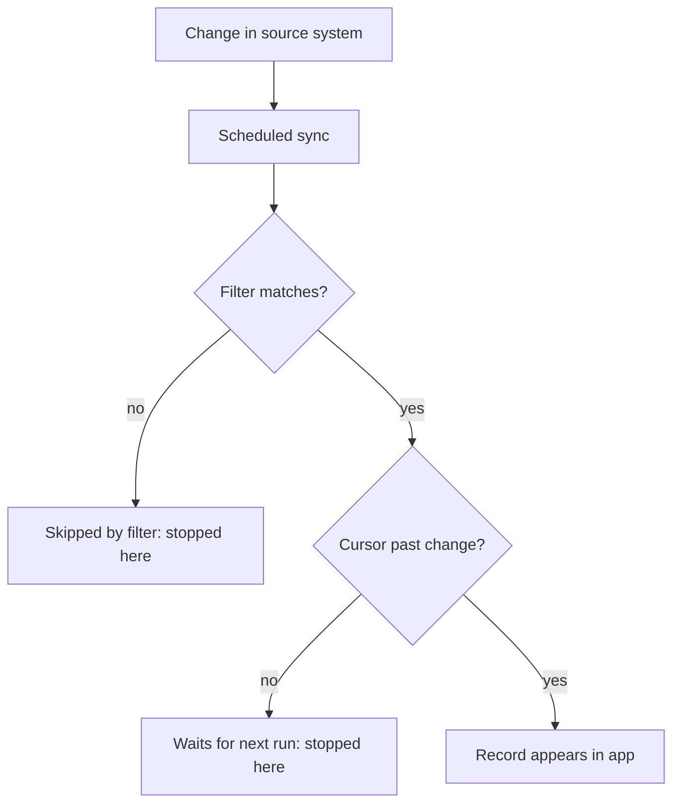

# Investigate the Cat

Turn a report into what kind of ask it is, a verdict, a cause (when relevant), and next checks. Describing how things work today is not the same as reporting something broken. Assume nothing is a code defect until the simpler causes are ruled out.

Read [`human-friendly`](../human-friendly/SKILL.md) before the final answer, the issue draft, and any reply meant for a user or customer.

## Roles

The user is usually the engineer. They own the evidence (code, data, logs, docs) and engineering decisions (is it a defect, what a fix costs). They do not own product, support, or customer decisions.

- Phrase each next step with its owner: "Support to …", "Product to …", "Engineering to …"
- Decisions that belong to someone else stay open as "Decision needed from <role>"
- Any message meant for a customer or partner is a draft for the owner to send. The engineer is never the sender

## Do not

- Change code, migrations, config or production data during the investigation. Triage and the issue come first. Implementation waits for an explicit ask, then [`implement-the-ant`](../implement-the-ant/SKILL.md)
- Post to chat tools or the tracker unless the user asks (draft only)
- Select secrets, auth headers, tokens, or full request and response bodies from logs or tables
- Paste customer names, emails, URLs, order numbers or thread quotes into repo files or skill examples

## Ask type (classify first)

| Ask type           | Signals                                                         | Default outcome |
| ------------------ | --------------------------------------------------------------- | --------------- |
| Incident       | Something failed, regressed, or differs from documented behaviour | Verdict, cause, gates |
| Clarification  | "Why does it…?", "Is it normal that…?", with no claim it is wrong | Explain the behaviour and set expectations |
| Change request | "We need…", "Can it…?", a new rule or timing                    | Confirm current behaviour, then hand to [`plan-the-lion`](../plan-the-lion/SKILL.md) if it is build work |
| Mixed          | Describes today's behaviour and asks for something new      | Split: (A) working as designed or config, (B) new or changed. Do not call (A) a bug because (B) was asked |

Expected behaviour (a poll, not a webhook; a filter that excludes an item; a delay until the next scheduled run) supports clarification or a change request. It is not, by itself, proof of a bug.

## Workflow

1. Ask type, and a one-line question: broken, working as designed, unknown, or "want different"
2. Read the full thread or issue, to the latest reply
3. Read the docs and the code for that behaviour, with path:line citations
4. Gather read-only data and log evidence
5. Run the checklist (tenant, environment, config, flags, timing, access, data)
6. Classify the cause
7. Verdict first, then evidence, then next steps by owner
8. One Mermaid diagram of the path, with the stop point marked
9. Issue draft (unless the user asked for chat only)

### Intake

Restate the question in one line. Note the ask type and where it happens (UI, API, job, webhook, integration). Separate current state (what the app does now, with evidence) from desired state (what they want).

### Live context

Read the full linked thread or issue to the latest reply. Summarise in chat only.

### Evidence

1. Find the docs for the area (`docs/`, `README.md`, design docs)
2. Read only the code paths that handle the reported behaviour. Cite `path:line`
3. Gather data read-only: database SELECTs with a `WHERE` and `LIMIT` and named columns, the app's admin API or UI, or log search. Prefer the API or UI for heavy log tables. Read metadata first (status, error, timestamp, ID). Open one full entry only when it decides the verdict

### Checklist (before calling it a code defect)

| Check       | Question |
| ----------- | -------- |
| Tenant      | Same account, team or workspace as where the data was created? |
| Environment | Right environment (local, staging, production) and matching credentials? |
| Config      | Feature flags, settings, and filters match the reported rule? |
| Cursor      | For syncs and jobs: is the last-run marker past the change? |
| Timing      | Has the scheduled interval passed since the change? |
| Access      | Does the user have the role or permission the action needs? |
| Data        | Does the referenced record actually exist where the code looks for it? |

Anything you cannot read from code, data or logs becomes "<Owner> to confirm".

### Classify the cause

For an incident or mixed (A), pick one primary cause, and note secondary factors:

1. Expected behaviour. Documented design. Often the full answer for a clarification
2. Config. Flags, settings, filters, or a disabled feature
3. Wrong environment. Wrong account, environment or credential
4. Timing. The next scheduled run has not happened yet
5. Access. Missing role or permission
6. Missing or bad data. The record does not exist, or is in a state the code does not expect
7. Code defect. The checks pass, and logs or a repro show the failure in code
8. Docs gap. Behaviour matches the docs, but the docs or messages are unclear
9. Change scope. Behaviour is correct, and the ask is for something new

## Visualize the path

Every verdict gets one Mermaid diagram of the path from trigger to outcome, with the stop point marked. Default to `flowchart TD`. Use `stateDiagram-v2` when the answer is a status that did not move. Draw only steps the code or docs show. A pure clarification with no flow gets one line saying why there is no diagram.



## Output format

```markdown
## Ask type

[Incident | Clarification | Change request | Mixed: A and B in one line]

## Verdict

[One or two sentences]

## What we checked

- [Docs, code and data checked, with no secrets]

## How it behaves

[The diagram, with one or two plain sentences]

## Likely cause

[Primary cause and one or two bullets]

## Next steps (by owner)

1. Support to …
2. Engineering to …

## Decisions needed

- Decision needed from <role>: <question>

## Issue draft

[Title, then description: current behaviour, expected behaviour, evidence, acceptance criteria]

## Suggested reply (optional)

[A calm, short draft for the owner to review and send]
```

## Evidence rules

- Evidence before verdict. No invented APIs or behaviour
- Cite log evidence by source and ID, not by payload
- Read-only: no commits, no fixes, no data writes
