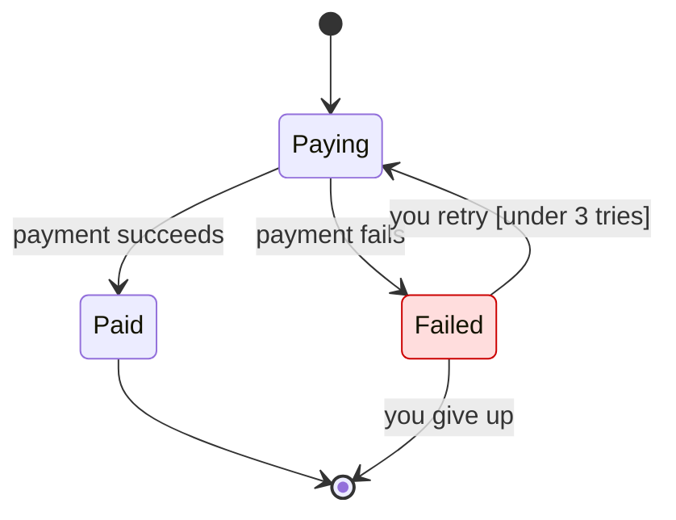

# Statechart the Hart

Read [`human-friendly`](../human-friendly/SKILL.md) before writing any text a person will read. Use plain words for a reader new to the topic. Keep commands, paths, numbers and dates exact.

Draw how a system moves between states, in the words of the person who reads the chart. That reader decides whether the behaviour is right.

Output is Mermaid text only. Do not install or run anything.

## When to use

Use it only when a picture of the states is truly needed. Good signs:

- A status field has 4 or more values, with rules about which move is allowed
- The flow has retries, timeouts, queues, webhooks, or two actors that race
- A bug is a wrong path through states, and prose does not make it clear
- A reviewer or a plan has to agree on the states before code is written

Do not use it for simple CRUD, one `if`, a straight list of steps, or a flow that [`draw-the-owl`](../draw-the-owl/SKILL.md) already shows well.

## When another skill calls this one

Planning, implementation, release and investigation skills may suggest this skill when the signs above are true.

- The calling skill suggests it in one line. It does not draw the chart unless the user agrees, or the request already asks for a chart
- The caller keeps its own flow. The chart is an extra
- If the signs above are not true, nobody suggests it

## Steps

1. Find the states and moves in the real code or docs. Search for status enums, constants, and the places that change them. Cite paths and symbols
2. List the states. Name each one by what the reader sees or cares about, such as "Paying" or "Lock held, write pending". Keep variable names out of labels
3. List the moves. Label each arrow with what happens, such as "you press pay" or "the connect fails"
4. Write a Mermaid `stateDiagram-v2`
5. Show it as a `mermaid` code block

## Chart rules

- Mark the start with `[*]`. Mark each end state with `--> [*]`
- When a move works only in some conditions, end its label with the condition in brackets, such as `you retry [under 3 tries]`
- When a hidden value decides where a move goes, name the result in the label, such as "the lookup fails"
- Aim for about 20 arrows or fewer. Merge states that act the same. Leave out details the reader does not need
- Keep each state reachable from the start. Give each non-end state at least one arrow out
- Say which moves you left out

## Mark broken states

When a state or move breaks a rule the reader agrees to, mark it so the reader can see where:

- Add a class: `classDef breaks fill:#fdd,stroke:#c00` and `class StateName breaks`
- Add a short note under the chart: the rule, the reader's sentence for that rule, and the path to it, step by step

Do not merge two states that break different rules.

## Example

## Hand off

Give the chart and its Mermaid text to the person who must decide. Add:

- One line for each bug: the rule, the reader's sentence for that rule, and the path
- What the chart leaves out

When the chart describes code, replay each bug path against the real code, as a test or a live repro, one step for each move. If a bug does not happen, assume the chart is wrong until you show it is not.

When the user asks for an image, render the Mermaid with any Mermaid renderer they already use (for example `@mermaid-js/mermaid-cli`), and ask before installing one.
