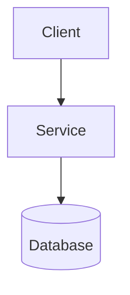
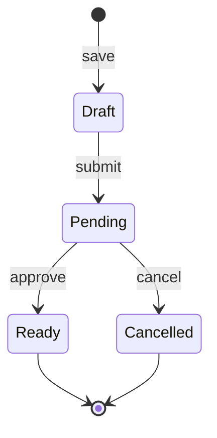
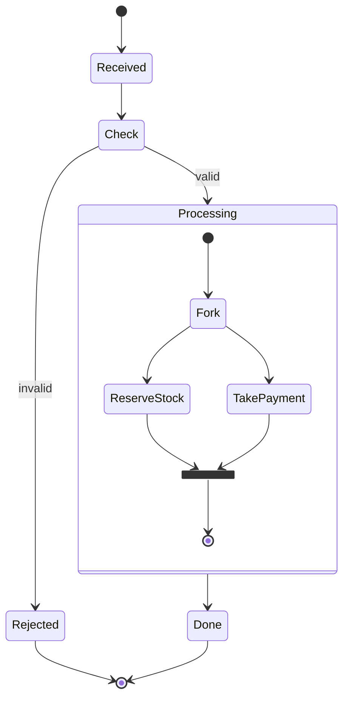
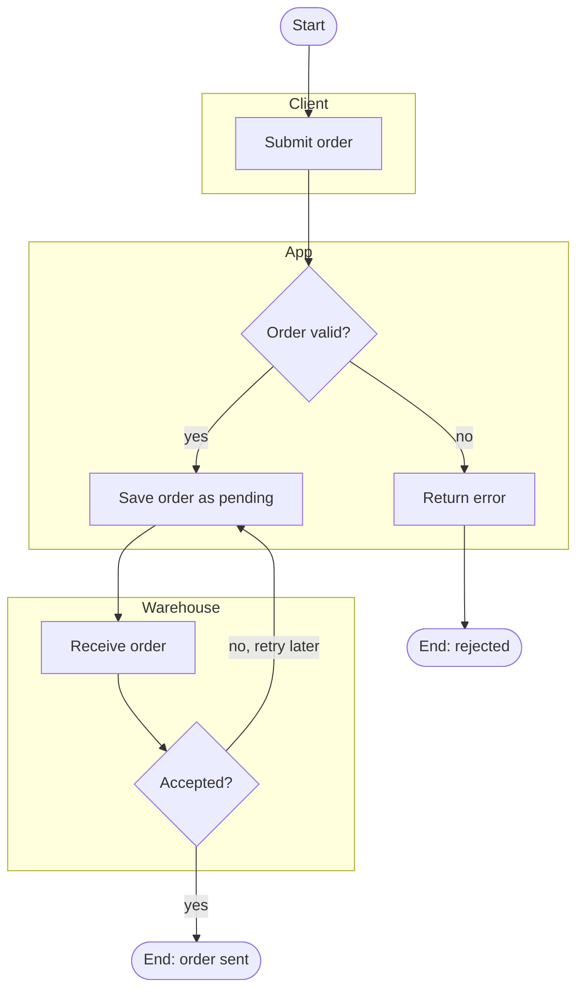
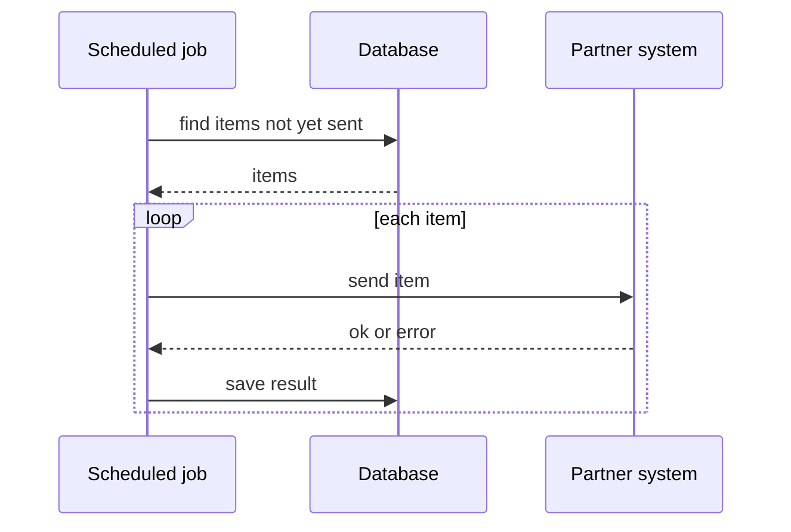
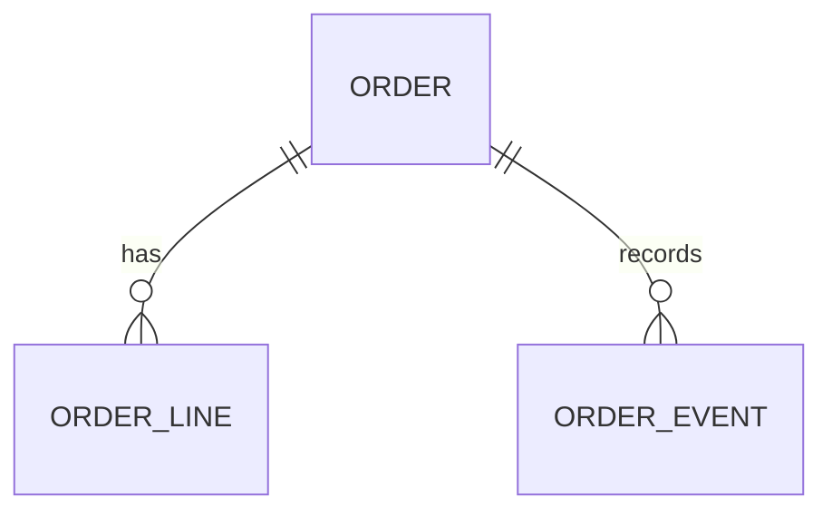
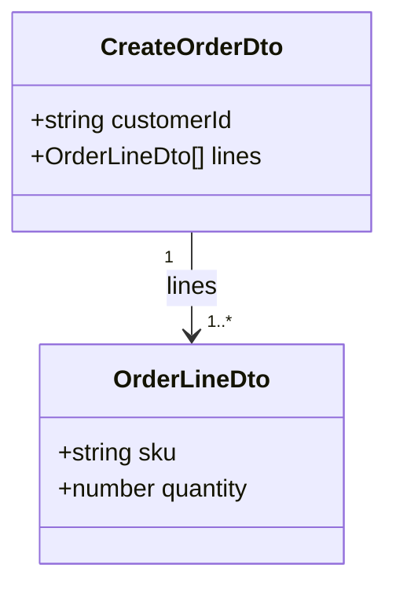
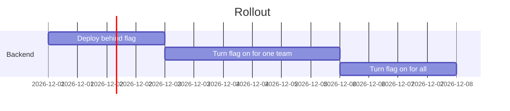

# TDD: <Title>

|                |                                                           |
| :------------- | :-------------------------------------------------------- |
| Owner          |                                                           |
| Type           | Backend, Frontend, Infra, Decision, or Investigation      |
| Status         | DRAFT, IN REVIEW, APPROVED, CANCELLED                     |
| Approvers      |                                                           |
| Approved on    |                                                           |
| Product doc    |                                                           |
| Issue or epic  |                                                           |

## 1. Summary

<3 to 5 sentences: what changes, for whom, and why now. Name this as a TDD or design. Do not write "this spike records…".>

## 2. Problem today

- <Short bullet: what hurts today.>
- <Short bullet.>

Optional: one diagram of how it works now.

## 3. Goals and out of scope

### Goals

- <Goal.>

### Out of scope

- <Item, and why.>

## 4. Words we use

| Term | Meaning |
| :--- | :------ |
|      |         |

List only terms the doc uses.

## 5. Proposed design

<Plain explanation first. Then the rules.>

Each decision names its source: product doc, team decision, or "our proposal".

## 6. Risks

| Risk | Impact | Likelihood | Plan | Owner |
| :--- | :----- | :--------- | :--- | :---- |
|      |        |            |      |       |

Plan is one of: reduce it, avoid it, hand it to someone else, or accept it (needs approval).

## 7. Acceptance scenarios

Cover the happy path, failure, empty input, duplicate, retry, and who-can-see-what cases that apply.

| Scenario | Given | When | Then |
| :------- | :---- | :--- | :--- |
|          |       |      |      |

## 8. Open questions and assumptions

| Question or assumption | Owner | Blocks what |
| :--------------------- | :---- | :---------- |
|                        |       |             |

## 9. Related links

- Product doc:
- Code (5 to 8 links at most):

---

## Optional sections

Add a section below only when this TDD needs it. Delete the rest. Number new sections between 5 and 6, and renumber.

| Section                   | What to put in it                                                        |
| :------------------------ | :----------------------------------------------------------------------- |
| Background                | History the reader needs to follow the problem.                          |
| Alternatives considered   | Each option, its trade-off, and why it was not chosen.                   |
| System architecture       | One `flowchart TD` of systems and how they talk, grouped with `subgraph`. |
| Sequence and flow         | One `sequenceDiagram` per job or integration.                            |
| Process flow              | An activity diagram (`flowchart TD`) for steps with decisions, loops, parallel work or swimlanes. |
| State machine             | A `stateDiagram-v2` plus the table below.                                |
| Types and contracts       | A `classDiagram` when the shape of DTOs or interfaces is the point.      |
| Rollout timeline          | A `gantt` or `timeline` for phased rollout. Real dates only.             |
| Data model                | An `erDiagram`, a column table, and an index table (index, query served, `performance` or `critical unique`). Rules are app-level. |
| Permissions               | Who can do what. Tenant or team scope.                                         |
| User interface            | Screens and user flow. Words, not pixels.                                |
| API endpoints             | Route, input, output, errors.                                            |
| Business logic            | The rules, as short statements.                                          |
| Changes to services       | What changes in each service.                                            |
| Errors and failures       | "If X, then Y" lines, including retries and duplicates.                  |
| Migration                 | How existing data moves. Old value to new value table.                   |
| Testing plan              | What proves the acceptance scenarios.                                    |
| Monitoring                | What is logged, measured, and alerted.                                   |
| Deployment and rollback   | Numbered rollout steps, feature flags, and the way back.                 |
| Performance               | Expected load and limits.                                                |
| Security                  | Data exposure, access, secrets.                                          |
| Cost                      | Run cost and build cost.                                                 |
| Operational readiness     | Who runs it, runbooks, support.                                          |
| Archiving                 | How old data is kept or removed.                                         |

## Sample: state machine

| State     | From    | Trigger | What happens             | Start or end |
| :-------- | :------ | :------ | :----------------------- | :----------- |
| Draft     | none    | Save    | Store partial input      | Start        |
| Pending   | Draft   | Submit  | Validate the input       |              |
| Ready     | Pending | Approve | Ready to send            | End          |
| Cancelled | Pending | Cancel  | Stop. Keep the history.  | End          |

## Sample: state machine with a decision and parallel work

## Sample: activity diagram (steps, decisions, swimlanes)

## Sample: one job per diagram

## Sample: data model

## Sample: types and contracts

## Sample: rollout timeline

